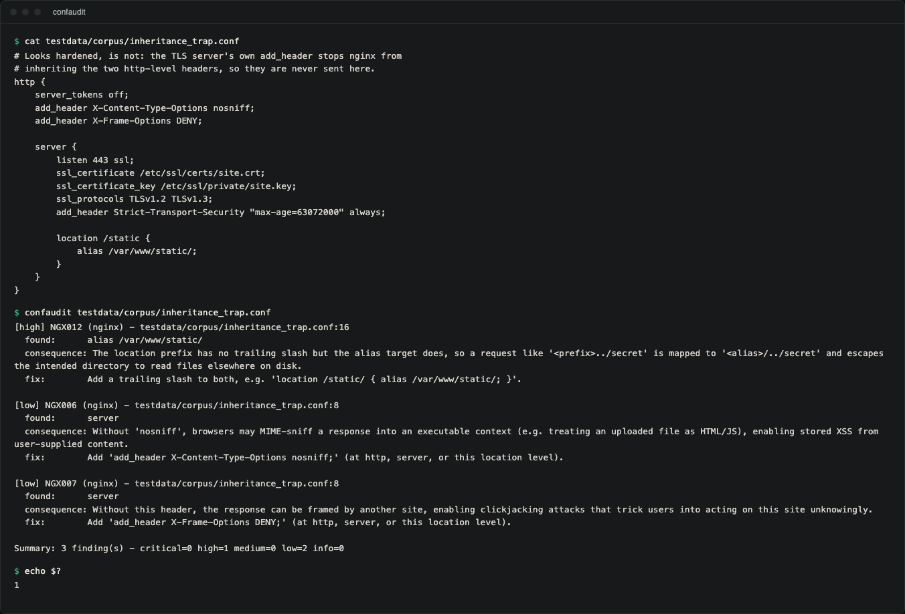
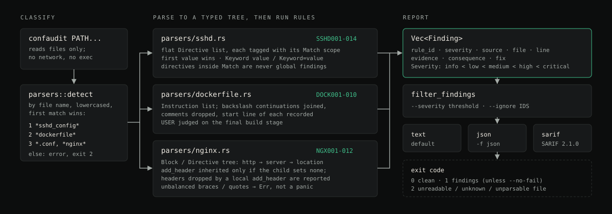

# confaudit

A CLI that audits `sshd_config`, nginx and `Dockerfile` files for settings
that weaken security, and says for each finding what an attacker gains or
what breaks.

`confaudit` reads the files you name and checks them against 36 rules for
well-known configuration mistakes: `PermitRootLogin yes`, directory
listings left on, a Dockerfile that never drops root, TLS 1.0 still
accepted, and so on. It checks security posture, not syntax.

Status: version 0.1.0. It is not published on crates.io, so install it
from source. CI builds and tests it on Linux, macOS and Windows.

## Demo



Real terminal capture of the release binary on one of the corpus fixtures.
The nginx file sets `X-Content-Type-Options` and `X-Frame-Options` at `http`
level, but the TLS `server` has its own `add_header`, so nginx inherits
neither. confaudit reports both dropped headers plus the off-by-slash
`alias`:

```
$ confaudit testdata/corpus/inheritance_trap.conf
[high] NGX012 (nginx) - testdata/corpus/inheritance_trap.conf:16
  found:      alias /var/www/static/
  consequence: The location prefix has no trailing slash but the alias target does, so a request like '<prefix>../secret' is mapped to '<alias>/../secret' and escapes the intended directory to read files elsewhere on disk.
  fix:        Add a trailing slash to both, e.g. 'location /static/ { alias /var/www/static/; }'.

[low] NGX006 (nginx) - testdata/corpus/inheritance_trap.conf:8
  found:      server
  consequence: Without 'nosniff', browsers may MIME-sniff a response into an executable context (e.g. treating an uploaded file as HTML/JS), enabling stored XSS from user-supplied content.
  fix:        Add 'add_header X-Content-Type-Options nosniff;' (at http, server, or this location level).

[low] NGX007 (nginx) - testdata/corpus/inheritance_trap.conf:8
  found:      server
  consequence: Without this header, the response can be framed by another site, enabling clickjacking attacks that trick users into acting on this site unknowingly.
  fix:        Add 'add_header X-Frame-Options DENY;' (at http, server, or this location level).

Summary: 3 finding(s) - critical=0 high=1 medium=0 low=2 info=0
$ echo $?
1
```

## Why

Server configs get copied from a blog post once and never revisited.
`PermitRootLogin yes` survives for years because nothing flags it.
An nginx `location` block serves directory listings. A Dockerfile runs as
root and bakes a secret into a layer that `docker history` shows to anyone
with pull access. Syntax linters check that the file parses, not that it is
safe. Each confaudit finding names the consequence and the fix, because
that is what gets a misconfiguration changed.

`confaudit` never makes a network request. It reads files on disk. If
you want to audit the HTTP response headers a live server actually
sends, use a different kind of tool.

## Features

- Three hand-written parsers rather than regexes over the raw text:
  - `sshd_config`, with correct `Match`-block scoping (a directive inside
    a `Match` block is conditional and is never reported as a global
    setting), first-value-wins semantics, and both `Keyword value` and
    `Keyword=value` syntax.
  - nginx, with a full block tree and directive **inheritance**
    (`http` -> `server` -> `location`) modelled the way nginx does it: a
    header set once at `http` level is recognized on every `server`
    beneath it, *unless* that `server` (or a `location`) has any
    `add_header` of its own, in which case nginx inherits none of them and
    confaudit reports the headers that are dropped.
  - `Dockerfile`, with backslash line-continuation joining and comment
    handling.
- 36 rules across the three formats (see the reference tables below).
- Text, JSON and [SARIF 2.1.0](https://docs.oasis-open.org/sarif/sarif/v2.1.0/sarif-v2.1.0.html)
  output. The SARIF file can be uploaded to GitHub code scanning.
- `--severity` threshold filtering and `--ignore` rule suppression.
- Non-zero exit status when findings meet or exceed the severity
  threshold, so it's usable as a CI gate.
- Malformed input (unterminated quotes, unbalanced braces, dangling line
  continuations) returns a clean error instead of panicking.

## Supported formats

The format is chosen from the file name (case-insensitive), checked in
this order; the first match wins:

| Order | Format        | File name                                                   |
| ----- | ------------- | ----------------------------------------------------------- |
| 1     | `sshd_config` | contains `sshd_config` (e.g. `sshd_config`, `bad_sshd_config`) |
| 2     | Dockerfile    | contains `dockerfile` (e.g. `Dockerfile`, `Dockerfile.prod`, `app.dockerfile`) |
| 3     | nginx         | ends in `.conf`, or contains `nginx`                        |

Any other file is reported as unrecognized and the run exits with status 2.

## Architecture



*Diagram: how a path flows through detection, parsing, rules, filtering and output.*

```
src/
  finding.rs        Finding/Severity/SourceKind: the shared result type
  parsers/
    sshd.rs          sshd_config tokenizer + Match-scope tracking + rules
    nginx.rs         nginx block-tree parser + inheritance-aware rules
    dockerfile.rs    Dockerfile instruction parser + rules
    mod.rs           file-kind detection
  output/
    text.rs, json.rs, sarif.rs
  lib.rs             ties parsing + filtering together for main.rs and tests
  main.rs            CLI (clap)
```

Each parser produces a small typed tree (or, for sshd, a flat list of
directives tagged with their `Match` scope) before any rule runs. Rules
never regex the raw file text. This is what makes the two hard cases
(conditional `Match` directives, inherited nginx headers) tractable and
testable.

## Installation

Requires Rust 1.74 or newer (the MSRV that CI builds and tests).

```
git clone https://github.com/hellpuffyt/confaudit.git
cd confaudit
cargo install --path .
```

Or build a binary without installing it:

```
cargo build --release
./target/release/confaudit --help
```

## Usage

```
$ confaudit --help
Audit nginx, sshd and Docker configuration files for settings that weaken security

Usage: confaudit [OPTIONS] <PATHS>...

Arguments:
  <PATHS>...  Configuration file(s) to audit (`sshd_config`, nginx *.conf, `Dockerfile`)

Options:
  -f, --format <FORMAT>      Output format: text, json, or sarif [default: text]
      --severity <SEVERITY>  Only report findings at or above this severity: info, low, medium, high, critical [default: info]
      --ignore <IGNORE>      Comma-separated rule IDs to suppress (e.g. `SSHD001,NGX002`)
      --no-fail              Exit with status 0 even if findings were reported
  -h, --help                 Print help
  -V, --version              Print version
```

Exit codes: `0` no findings at or above the threshold, `1` findings
reported, `2` a file could not be read, recognized or parsed, or a
`--format`/`--severity` value was invalid. With several paths, the other
files are still audited and reported before the run exits with `2`.

## Rules reference

### sshd_config

| Rule ID | Severity | Trigger | Consequence |
| ------- | -------- | ------- | ----------- |
| SSHD001 | Critical / Medium | `PermitRootLogin yes`, or unset | Direct root login skips privilege escalation entirely |
| SSHD002 | High | `PermitRootLogin without-password`/`prohibit-password` | Root key login stays possible with no second factor |
| SSHD003 | High | `PasswordAuthentication yes` | Exposes the server to credential-stuffing/brute force |
| SSHD004 | Critical | `PermitEmptyPasswords yes` | Blank-password accounts need no credential at all |
| SSHD005 | Critical | `Protocol 1` present | SSHv1 is trivially MITM'd |
| SSHD006 | High | Weak `Ciphers` (CBC/RC4) | Vulnerable to plaintext-recovery attacks |
| SSHD007 | High | Weak `MACs` (MD5/SHA1-96) | Vulnerable to forgery/collision attacks |
| SSHD008 | High | Weak `KexAlgorithms` (SHA-1/small DH) | Weakens forward secrecy (Logjam-style) |
| SSHD009 | Low | `X11Forwarding yes` | Increases attack surface via X11's weak client isolation |
| SSHD010 | Low | `AllowTcpForwarding yes` | Lets any user pivot the server into an arbitrary proxy |
| SSHD011 | Low | Missing/high `MaxAuthTries` | Cheaper online brute-force attempts |
| SSHD012 | Medium | `PermitUserEnvironment yes` | Enables `LD_PRELOAD`-style privilege escalation |
| SSHD013 | Medium | `UsePAM no` | Skips account lockout/expiry controls |
| SSHD014 | Info | Missing `ClientAliveInterval` | Idle sessions never get dropped |

### nginx

| Rule ID | Severity | Trigger | Consequence |
| ------- | -------- | ------- | ----------- |
| NGX001 | High | `autoindex on` | Directory listing exposes filenames an attacker would otherwise guess |
| NGX002 | Low | `server_tokens on` | Discloses nginx version for CVE matching |
| NGX003 | Medium | Non-TLS `server` with no HTTPS redirect | Credentials/cookies can travel in cleartext |
| NGX004 | High | Weak `ssl_protocols` (TLSv1/1.1/SSLv2/SSLv3) | Known protocol weaknesses, downgrade attacks |
| NGX005 | High | Weak `ssl_ciphers` (RC4/MD5/3DES/NULL/EXPORT) | Plaintext-recovery/downgrade attacks |
| NGX006 | Low | Missing `X-Content-Type-Options` (inheritance-aware) | Enables MIME-sniffing-based stored XSS |
| NGX007 | Low | Missing `X-Frame-Options` (inheritance-aware) | Enables clickjacking |
| NGX008 | Low | Missing `Strict-Transport-Security` on a TLS server | Allows SSL-stripping fallback to HTTP |
| NGX009 | Medium | `client_max_body_size 0` | Unbounded upload size enables resource-exhaustion DoS |
| NGX010 | Medium | `proxy_pass` without `proxy_set_header Host` (inheritance-aware) | Breaks host-based routing / backend vhost checks |
| NGX011 | Medium | Non-`return`/`rewrite`/`break`/`set` directive inside `if` | nginx's `if` misbehaves outside that narrow set |
| NGX012 | High | `location` prefix without a trailing slash whose `alias` has one (`location /static { alias /var/www/static/; }`) | `/static../x` maps to `/var/www/static/../x`: path traversal ("off-by-slash") |

### Dockerfile

| Rule ID | Severity | Trigger | Consequence |
| ------- | -------- | ------- | ----------- |
| DOCK001 | High | No `USER` in the final build stage, or `USER root`/`0` | Compromise runs as container root |
| DOCK002 | Medium | `latest` tag or no tag | Build is not reproducible; base can silently change |
| DOCK003 | Medium | `ADD` from `http(s)://` | No integrity check on the fetched content |
| DOCK004 | Critical | Secret-shaped key in `ENV`/`ARG` with a value | Baked permanently into image layer history |
| DOCK005 | Low | `apt-get install` missing `--no-install-recommends` or cache cleanup | Bloats image and installed-package attack surface |
| DOCK006 | High | `curl`/`wget` piped into `sh`/`bash` | Arbitrary code execution from an unverified download |
| DOCK007 | High | `--privileged` referenced in a `RUN` | Disables container isolation for anything relying on it |
| DOCK008 | Info | No `HEALTHCHECK` | Orchestrators can't detect a hung process |
| DOCK009 | Low | `sudo` in a `RUN` | Redundant during build; risky if it reaches runtime |
| DOCK010 | Info | `COPY . .` before the dependency install step | Busts the layer cache on every source change |

## Examples

```
$ confaudit testdata/sshd/bad_sshd_config
[critical] SSHD001 (sshd) - testdata/sshd/bad_sshd_config:4
  found:      PermitRootLogin yes
  consequence: An attacker who obtains or brute-forces any valid credential (password or key) can log in directly as root, skipping privilege escalation entirely.
  fix:        Set 'PermitRootLogin no' and use sudo with a named account for administrative access.
...
Summary: 13 finding(s) - critical=3 high=4 medium=2 low=3 info=1
```

```
$ confaudit --format sarif testdata/nginx/bad.conf > results.sarif
```

```
$ confaudit --severity high --ignore DOCK008 testdata/docker/Dockerfile.bad
[critical] DOCK004 (dockerfile) - testdata/docker/Dockerfile.bad:5
  found:      ARG API_TOKEN=fake-build-time-token-do-not-use
...
Summary: 4 finding(s) - critical=2 high=2 medium=0 low=0 info=0
```

All three commands exit with status `1` because findings were reported.

JSON output is an object with a `findings` array and a `summary` of counts
per severity. A clean file gives:

```
$ confaudit -f json testdata/docker/Dockerfile.good
{
  "findings": [],
  "summary": {
    "total": 0,
    "critical": 0,
    "high": 0,
    "medium": 0,
    "low": 0,
    "info": 0
  }
}
```

## Testing

```
cargo test --all-targets      # 154 tests: 141 unit, 13 CLI
```

The suite covers every rule in both directions (triggers and does-not-
trigger), plus:

- an sshd directive inside a `Match` block is never reported as a global
  setting;
- an nginx header inherited from `http` is never reported missing on a
  child `server`, and a local `add_header` that discards inherited ones is
  reported;
- `testdata/corpus/` holds realistic false-positive / false-negative cases
  (nginx inheritance trap, multi-stage Dockerfiles, `Keyword=value` and
  `-algorithm` sshd syntax), each pinned to its exact rule-ID set by
  `tests/cli.rs`;
- line-number accuracy across flat, nested, and continuation-joined
  input;
- malformed input (unterminated quotes/strings, unbalanced braces,
  dangling backslash continuations) returns a clean `Err` instead of
  panicking;
- CLI-level tests against the fixtures in `testdata/` covering exit
  codes, `--ignore`, `--no-fail`, and all three output formats.

## Limitations

- `Include` (sshd and nginx) is not followed; only the named file is audited.
- sshd defaults are mostly not inferred: an unset `PasswordAuthentication`
  (OpenSSH default `yes`) is not reported; an unset `PermitRootLogin` is.
- nginx `map`/variables and `if` semantics are not evaluated; header
  coverage is judged per `server` and its top-level `location` blocks.
- Dockerfile `ARG`-substituted image names and users are not expanded.

## Security

Report vulnerabilities privately as described in [SECURITY.md](SECURITY.md).

`confaudit` only reads files you point it at; it makes no network
requests and executes nothing from the files it audits. The fixtures in
`testdata/` use obviously fake secret values (e.g.
`fake-build-time-token-do-not-use`); they exist to exercise the secret-
detection rule, not as real credentials.

## Contributing

See [CONTRIBUTING.md](CONTRIBUTING.md).

## License

MIT. See [LICENSE](LICENSE).
